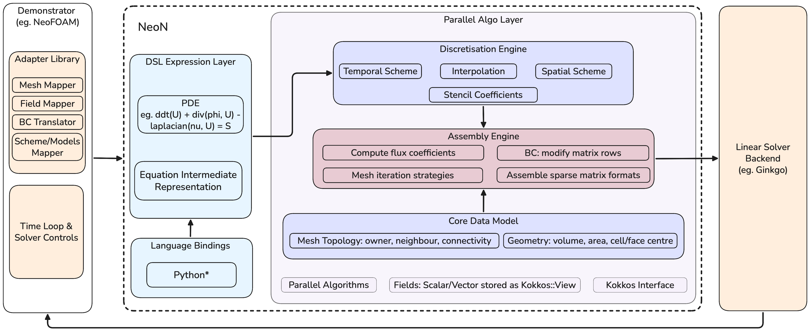

# Summary
NeoN is an open-source `C++20`-compliant library for developing high-performance computational fluid dynamics (CFD) software on heterogeneous GPU and multicore CPU systems. It provides a domain specific language (DSL) for expressing partial differential equations through finite-volume operators, while retaining fine-grained control over discretisation, matrix assembly and execution. Discretisation policies generate stencil coefficients, which are assembled into standard sparse matrix formats (e.g., CSR) and solved using external linear solver backends such as Ginkgo. NeoN utilises lazy evaluation to defer matrix assembly until execution. This architecture avoids unnecessary temporaries during matrix assembly and enables optimisations on the abstract syntax tree (AST), for example via fused GPU kernels with higher arithmetic intensity. Additionally, NeoN is designed to be integrated into other CFD frameworks through its API. To ensure performance across architectures while guaranteeing correct results, NeoN employs a robust continuous integration system that includes automated build validation, extensive GPU compatibility testing on AMD, NVIDIA, and Intel GPUs, and automated benchmarking.

# Statement of Need
The finite volume method (FVM) is a widely used discretisation approach in academic and industrial CFD applications due to its exact local conservation, robustness and flexibility. However, many of the widely used CFD frameworks were originally designed for single-core or moderately parallel CPU architectures. Since the development of classical open-source FVM codes like OpenFOAM [@weller1998] and `code_saturne` [@archambeau2004], computer hardware has evolved significantly: floating-point operations have become relatively inexpensive, while data movement has emerged as the primary performance bottleneck. Modern high-performance computing (HPC) platforms are inherently parallel, with hierarchical memory systems and accelerator-centric architectures, where performance is often limited by memory bandwidth rather than raw compute capability - an issue particularly relevant for CFD workflows, which are typically memory-bound with low arithmetic intensity. Accelerator-based architectures are increasingly adopted in modern HPC systems for scientific computing and AI, but legacy CFD codes often rely on backend-specific adaptations or refactoring, which complicate performance optimisation on such architectures [@olenik2024].

NeoN targets this gap by providing a versatile performance-portable CFD core that seamlessly integrates GPU-native data structures and finite-volume operator abstractions within a unified programming model. Using Kokkos [@trott2022] to implement a platform-portable parallelisation layer and a domain-specific interface for discretisation operators, NeoN enables the creation of modern CFD solvers, as demonstrated in NeoFOAM [@neofoam]. These solvers can efficiently target a variety of CPU-GPU architectures without being restricted to a single hardware backend or requiring duplicate numerical implementations. Additionally, through its companion project NeoFOAM, NeoN facilitates progressive modernisation of legacy solvers, including OpenFOAM-based codes, with minimal refactoring.

# State of the Field
Over the past two decades, significant efforts have been devoted to developing an abstraction mechanism and domain-specific representations for FVM codes. Early CFD frameworks, such as OpenFOAM, introduced object-oriented tensorial abstractions [@weller1998] in `C++`, enabling finite-volume discretisations to be expressed in a compact and expressive form that has seen widespread industrial adoption. Despite their success, these abstractions are typically integrated within solver-specific infrastructures, making it difficult to reuse finite-volume components or achieve interoperability between independently developed CFD frameworks. This tight coupling also shapes accelerator support in OpenFOAM. Initiatives include offloading linear solvers using PETSc4FOAM [@bna2020] and OGL [@olenik2024], as well as broader offloading capabilities through OpenMP target directives [@tandon2024] and standard C++ execution policies introduced in OpenFOAM v2606 [@kumar2026]. However, these solutions remain specific to OpenFOAM and do not facilitate the development of reusable, performance-portable finite-volume components across different CFD frameworks.
Embedded DSLs like Life [@prudhomme2007] demonstrate improved expressiveness of numerical formulations, yet struggle with solver-agnostic semantics and performance portability. In contrast, external DSLs and code-generation frameworks - such as ExaSlang [@kuckuk2016], ExaStencils [@lengauer2014] and Dawn [@osuna2020] have enabled aggressive optimisation of stencil-based operators [@kuckuk2017]. However, they are restricted to structured discretisations and predefined numerical patterns, and are not designed to support the unstructured FV methods prevalent in general-purpose and industrial CFD. Recent efforts, such as Finch [@heisler2022] and ProtoX [@mankad2024], offer high performance portability, although they remain closely tied to specific solver frameworks, grid structures, or code-generation pipelines.
The existing works demonstrate that core finite-volume concepts - such as flux evaluation, control-volume integration, and discrete operators - can be expressed at a high level and optimised effectively when decoupled. Yet, a persistent gap remains: the lack of a modular CFD core that integrates high-level finite-volume abstractions with performance-portable execution on heterogeneous CPU-GPU architectures. NeoN aims to address this gap by combining the usability of embedded DSLs with the optimisation potential of external DSL approaches through a high-level finite-volume operator interface with lazy evaluation and performance-portable execution on heterogeneous architectures.

# Software Design
{width=100%}

NeoN is built around a layered, modular architecture as illustrated in \autoref{fig:neon-arch}. Its design cleanly separates the distinct stages: DSL-based equation representation, discretisation, matrix assembly, and linear solver. This separation allows each layer to evolve independently, making the framework highly extensible and maintainable.
At the heart of NeoN is a `C++` embedded DSL that allows users to express partial differential equations in a form close to their mathematical  representation, while the corresponding finite-volume discretisation is performed internally by the framework. Differential operators like `ddt`, `div`, `laplacian`, or `grad` can be composed directly into equation expressions, for example:

```cpp
auto expr = dsl::imp::ddt(U) + dsl::imp::div(phi, U) - dsl::imp::laplacian(nu, U);
```
**Listing 1:** Example expression with multiple differential operators.

Here, `imp` and `exp` denote implicit and explicit operators: implicit operators contribute coefficients to the system matrix, whereas explicit operators are evaluated from the known field values and contribute to the right-hand side. They are analogous to OpenFOAM's `fvm` and `fvc`, respectively, but unlike these, neither is evaluated eagerly. Instead, NeoN employs lazy evaluation to build an intermediate representation that is later interpreted by the discretisation engine. This approach avoids unnecessary temporary allocations and reduces memory traffic. Thus, the expression shown in Listing 1 is only fully assembled when an operation like `solve(expr, …)` requires the assembly.
The discretisation engine then applies selected temporal and spatial schemes to generate local stencil contributions for the finite-volume formulation. The core data model encapsulates mesh topology, geometric metrics, and scalar or vector fields in performance-portable memory abstractions. These contributions are then forwarded to an assembly engine that constructs a linear system of equations in common sparse matrix storage formats such as CSR and COO, rather than solver-specific representations. This design choice improves interoperability with external solver libraries. NeoN integrates Ginkgo [@anzt2022; @ginkgo] to solve the resulting sparse linear systems, providing access to portable and scalable iterative solvers and preconditioners.
High-level workflow concerns such as time loops, solver control, and I/O are intentionally handled outside the core library by external applications. The `Demonstrator` (e.g. NeoFOAM) illustrates how NeoN can be integrated into OpenFOAM-style workflows. Importantly, NeoN operates independently of OpenFOAM, and its Python bindings facilitate access to the DSL without NeoFOAM.

# Performance Evaluation
{width=100%}

To evaluate the performance of NeoN, the wall-clock time required for the matrix assembly of the expression defined in Listing 1 is measured across multiple hardware backends and problem sizes. The computational domain consists of a unit cube discretised using a uniform hexahedral mesh with varying resolutions. Benchmarks are conducted on representative high-performance computing hardware, including an AMD EPYC 9555 processor (64 cores), NVIDIA A100, H100 and H200 GPUs, an AMD MI210 GPU, and an Intel Data Center GPU Max 1100 (PVC). \autoref{fig:neon-performance}(Left) reports the assembly time per cell for different grid resolutions, comparing single-core CPU execution, multi-core CPU execution (16 threads), and GPU execution on an A100, H100, H200, MI210 and PVC device. The results indicate that GPU acceleration reduces the assembly time per cell relative to single-core CPU execution by a factor of approximately 15 to 155, depending on the device and grid resolution, with the largest gains on the H100 and H200 for the finest grids.
In addition, strong scaling experiments using the OpenMP backend on up to 32 CPU cores are presented in \autoref{fig:neon-performance}(Right). Up to eight threads, the speedup is close to linear. At 16 and 32 threads, speedups of approximately 11x and 13x are achieved for most resolutions. The diminishing gains beyond 16 threads are attributed to memory bandwidth limitations leading to increased contention among threads.

# Research Impact Statement
NeoN has documented use in the EXASIM research project [@exasim-report], where it is presented as an approach for GPU-based assembly of finite-volume operators on heterogeneous CPU/GPU systems. This demonstrates its use in active CFD research workflows.

# AI Usage Disclosure
NeoN's architecture, core abstractions, and numerical foundations were developed prior to the introduction of AI coding assistants into the project workflow. Recently, contributors, including some of the authors, have used GitHub Copilot and Anthropic's Claude models for selected tasks such as automated review fixes, CI and packaging scripts, individual features with tests, and performance refactoring; these commits are marked with co-author trailers. Additionally, OpenAI's GPT-5.4 has been used to enhance the clarity, conciseness, and grammatical accuracy of the manuscript. All AI-assisted contributions were reviewed and approved by human maintainers, who remained responsible for the software's design, correctness, and scientific accuracy. The authors take full responsibility for both the software and the manuscript.

# Acknowledgements
The authors thank Prof. Hartwig Anzt (Chair of Computational Mathematics, Technical University of Munich) for his leadership in establishing NeoN as part of the EXASIM initiative and for his continued scientific guidance and supervision.

Parts of this work were supported by the German Federal Ministry of Education and Research (grant number 16ME0676K).

# References
